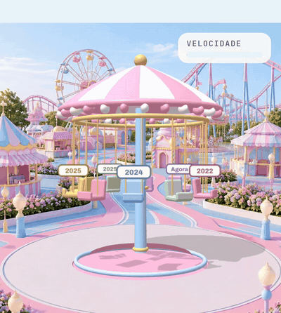
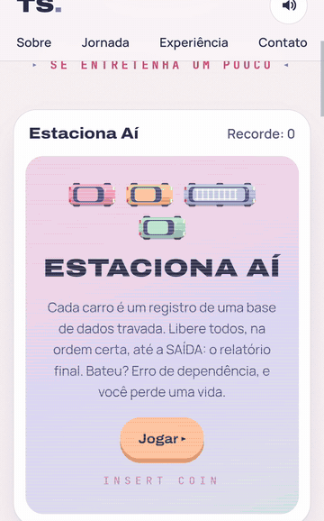
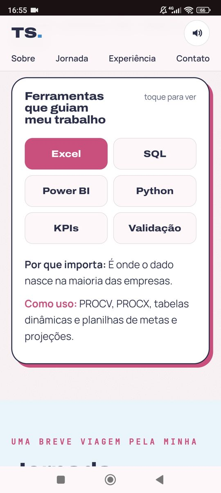

# Thalissa Silva | Análise de Dados & BI

Currículo interativo: https://thalissakezia.github.io

  
  

## O que tem no site
- **Estaciona Aí**: jogo em que cada carro é um registro de uma base de dados.
  Liberar na ordem certa é como resolver dependências num fluxo de dados (ETL).
  As fases são geradas aleatoriamente, e um algoritmo testa se cada uma tem solução
  antes de mostrar.
- **Raio-X da partida**: análise do desempenho de quem joga, com tempo médio de decisão,
  precisão, ritmo, pontos fortes e pontos de atenção.
- **Ranking** com apelido e personagem.
- **Jornada em 3D**: brinquedo de parque feito com Three.js que gira com os toques.
  Cada cadeirinha é uma fase da minha trajetória.

## Telas

| Jogo | Ferramentas |
| --- | --- |
|  |  |

## Tecnologias
- HTML, CSS e JavaScript puro
- Three.js (3D no navegador)
- Web Audio API (sons gerados pelo código)
- GitHub Pages (hospedagem)

## Formação
- Pós-graduação em Business Intelligence, Big Data e IA (Universidade Focus, 2025)
- Análise e Desenvolvimento de Sistemas (Estácio)

## Contato
thalissakezia.ti@gmail.com · [LinkedIn](https://www.linkedin.com/in/thalissakezia)
